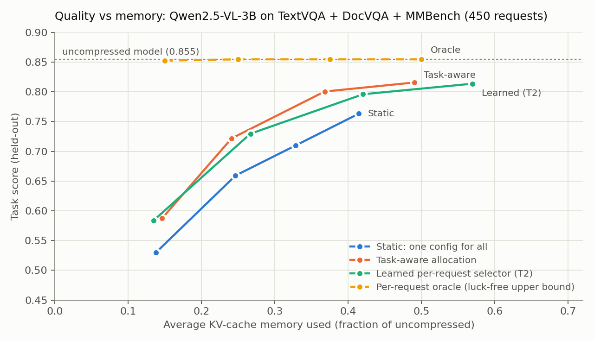
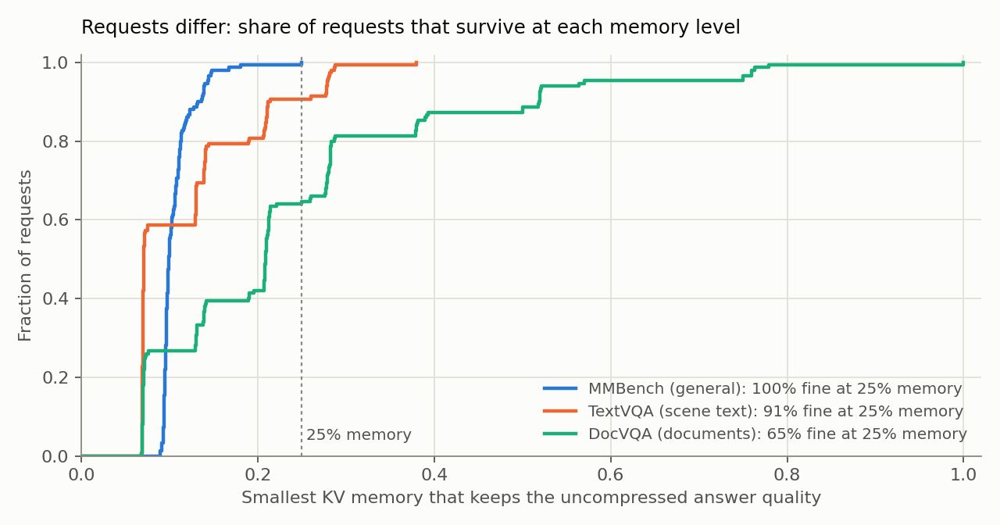
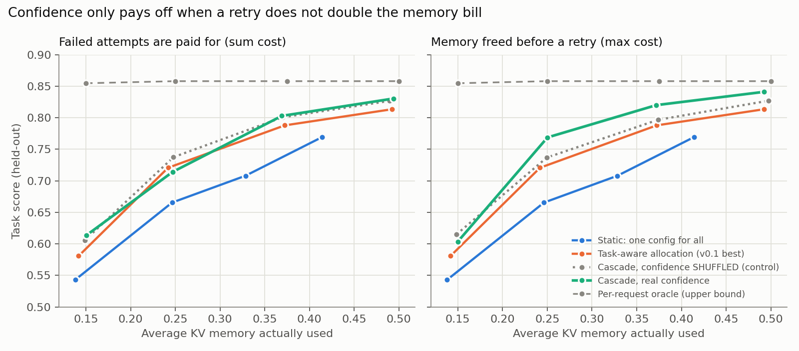
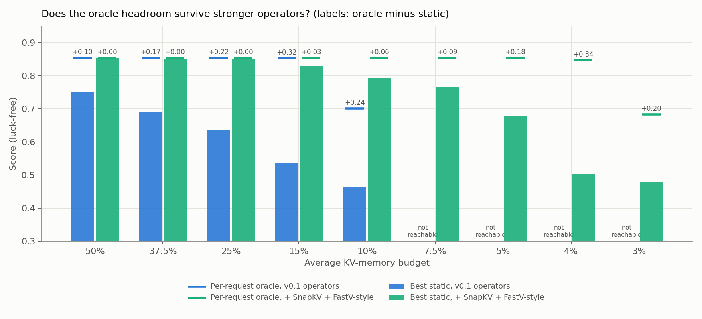
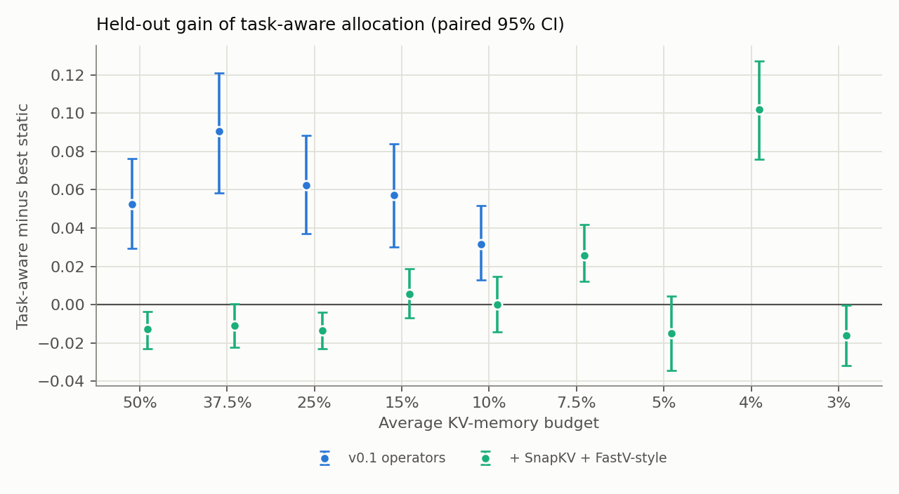
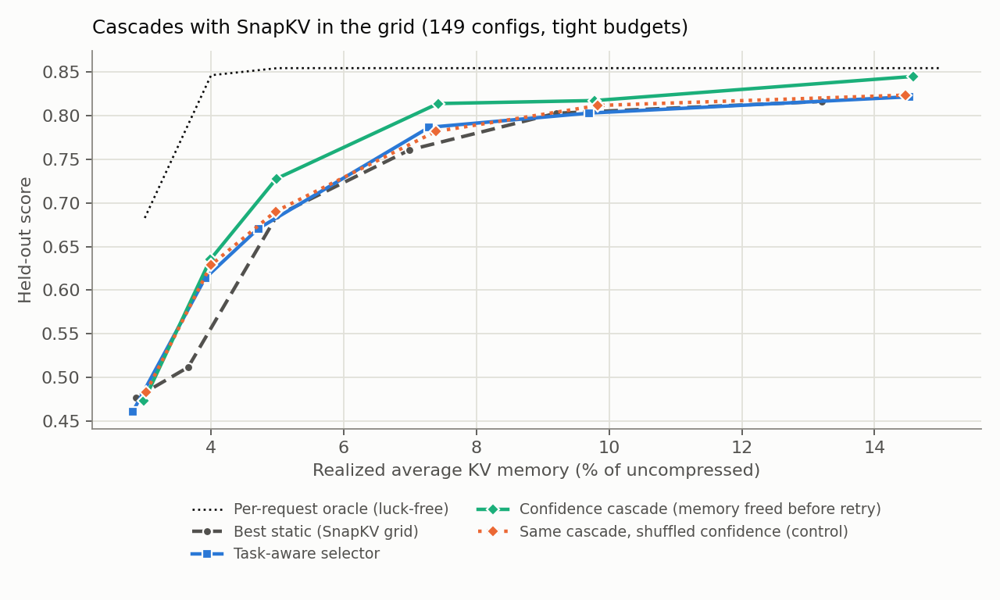
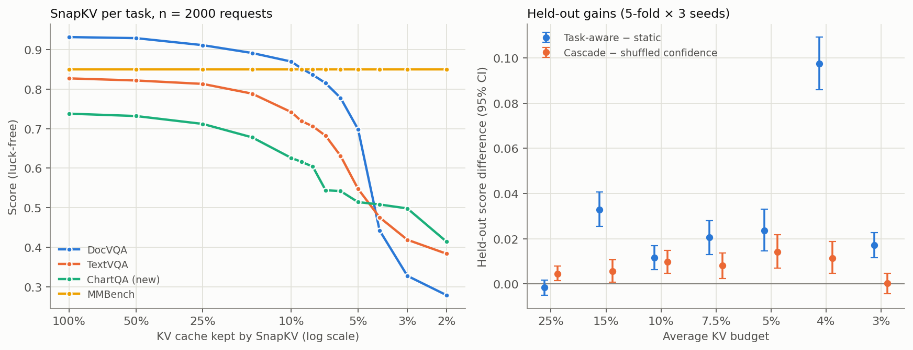
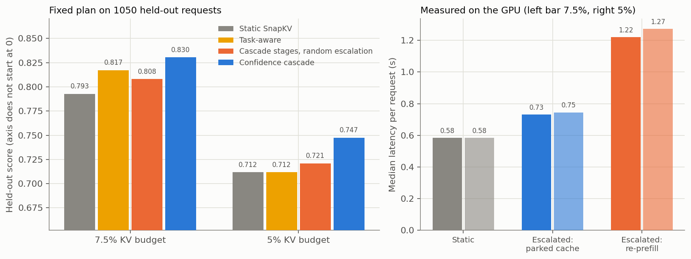
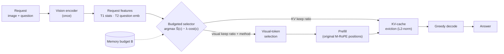

<div align="center">

# UniInfer

**Request-adaptive inference budgets for vision-language models**

*Not every request needs the same memory. UniInfer measures how much each request can be compressed,
then learns to spend a fixed memory budget where it matters.*

[](https://github.com/Rakshitha-Ireddi/UniInfer/actions/workflows/ci.yml)
[](LICENSE)


[Results](#results-v01) · [v0.2 cascades](#results-v02-confidence-cascades) · [v0.2 baselines](#results-v02-strong-baselines) · [How it works](#how-it-works) · [Quickstart](#quickstart) · [Reproduce](#reproduce-the-paper-numbers) · [Roadmap](ROADMAP.md) · [Design decisions](docs/adr/README.md) · [Contributing](CONTRIBUTING.md)

</div>

---

## Why

Vision-language models spend most of their input on **visual tokens**: 391 of 430 input tokens for a single
640×480 image in Qwen2.5-VL. Every one of them occupies **KV-cache memory** for the whole generation.
Existing work compresses visual tokens or the KV cache **by a fixed ratio for every request**.

But requests differ. *"What colour is the car?"* survives aggressive compression. *"What is the total on
line 14 of this invoice?"* does not. UniInfer asks:

> **Under a fixed memory budget, can choosing compression per request beat the best one-size-fits-all
> setting, and can a cheap predictor make that choice before answering?**

## Results (v0.1)

Qwen2.5-VL-3B · 450 requests (150 each from TextVQA, DocVQA and MMBench) · 28 compression configs per request
(visual-token keep ratio × pruning method × KV-cache keep ratio) · all numbers held-out (5-fold CV × 3 seeds).

<picture>
  <source media="(prefers-color-scheme: dark)" srcset="docs/figures/quality_vs_memory_dark.png">
  
</picture>

**Finding 1: the headroom is large.** A per-request oracle keeps **full quality (0.855) at 15% of the KV
memory**. The best single static config scores 0.536 at that budget, a gap of **+0.316 (95% CI
[0.280, 0.341])**. This is a luck-free upper bound: no credit is given when a compressed config beats the
uncompressed model. CIs come from a stratified request bootstrap that re-selects every config inside each
replicate (`python experiments/oracle/analyze.py`).

> **Update (v0.2 baselines):** most of this headroom comes from the weak v0.1 KV operator. With SnapKV in the
> grid, the best static config keeps full quality down to 25% memory and the gap at 15% shrinks to +0.026.
> The headroom comes back near SnapKV's cliff (+0.34 at 4% memory). See
> [Findings 7–11](#results-v02-strong-baselines).

**Finding 2: requests differ, and by task.** At 25% memory, every MMBench request and 91% of TextVQA
requests keep their full-quality answer, but only 65% of DocVQA requests do.

<picture>
  <source media="(prefers-color-scheme: dark)" srcset="docs/figures/request_sensitivity_dark.png">
  
</picture>

**Finding 3: cheap learned selection recovers part of the gap, but not yet from per-request signals.**

| Avg. KV budget | Static | Task-aware | Learned T1 (1.4 ms) | Learned T2 | Learned T3 (+91 ms) | Oracle (raw) |
|:-:|:-:|:-:|:-:|:-:|:-:|:-:|
| 50% | 0.763 | 0.816 | **0.819** | 0.814 | 0.821 | 0.909 |
| 37.5% | 0.710 | **0.800** | 0.798 | 0.796 | 0.792 | 0.909 |
| 25% | 0.659 | 0.722 | 0.719 | **0.730** | 0.732 | 0.909 |
| 15% | 0.530 | 0.587 | **0.600** | 0.584 | 0.575 | 0.903 |

<sub>Mean over 3 seeds (std ≤ 0.014). Learned selectors overshoot the budget by 1–7 points of memory; the
figure plots realized cost. T1 = image/visual-token statistics plus question-text features, T2 = +
question embedding, T3 = + hidden state from a full prefill. Full tables:
[`results/v0.1-oracle/`](results/v0.1-oracle/).</sub>

Learned selection gains **+6 to +9 points over static**, but a selector that sees **only the task label**
does about as well. Most of today's gain comes from moving memory *between task types*. Closing the
remaining gap to the oracle with *per-request* signals is the open research problem, and it drives
[v0.2](ROADMAP.md).

## Results (v0.2): confidence cascades

Can the model's own confidence tell us *which* requests a cheap config damaged? Answer cheaply, and
escalate to a larger budget only when unsure. Full write-up:
[`experiments/cascade/`](experiments/cascade/README.md).

<picture>
  <source media="(prefers-color-scheme: dark)" srcset="docs/figures/cascade_frontier_dark.png">
  
</picture>

**Finding 4: the per-request signal exists.** The minimum token log-prob of the answer separates kept
answers from damaged ones with **AUROC 0.85**. First-token confidence, the usual cascade signal, is at
chance on DocVQA (0.49).

**Finding 5: but it does not pay for itself when retries cost double.** A per-task cascade beats task-aware
allocation at 15% memory (+3.3 points, 95% CI [+1.1, +5.6]). However, **the same cascade with confidence
shuffled across requests does just as well**. The gain comes from mixing two configs per task, not from
the signal.

**Finding 6: confidence pays off once a retry is cheap.** If the cheap attempt's memory is freed before
the retry, real confidence beats the shuffled control by **+1.4 to +3.2 points** at 3 of 4 budgets
(paired bootstrap CIs exclude 0), and beats task-aware allocation by up to +4.8. The bottleneck is
*escalation cost*, which makes cheap re-compression of a retained cache a v0.3 serving problem.

### What compression looks like on one request

```text
visual 100%  kv 100%  ->  "...a red square and a blue circle. The invoice total ... is $482.17."
visual  50%  kv 100%  ->  "...a red square and a blue circle. The invoice total ... is $482.17."
visual  50%  kv  50%  ->  "...a red circle and a blue circle. The invoice total ... is $4."
visual  25%  kv  25%  ->  "The image shows a handwritten note with the following details:"
```

## Results (v0.2): strong baselines

Does the headroom survive a stronger static operator? We add **SnapKV** (KV eviction) and **FastV-style**
visual pruning, plus **PyramidKV**, all guided by attention that we rebuild on SDPA and verify layer by layer
([ADR-0009](docs/adr/0009-attention-guided-baselines.md)). Same 450 requests, now 149 configs each, down to
2% of the KV cache. Full write-up: [`experiments/baselines/`](experiments/baselines/README.md).

<picture>
  <source media="(prefers-color-scheme: dark)" srcset="docs/figures/headroom_operators_dark.png">
  
</picture>

**Finding 7: SnapKV removes most of the v0.1 headroom.** On its own, SnapKV keeps 0.850 of 0.855 at 25% of
the KV cache, where L2-norm eviction drops to 0.590. With it, the oracle-static gap is **+0.005 at 25% memory**
(it was +0.217) and **+0.026 [+0.015, +0.061] at 15%** (it was +0.316). FastV-style pruning helps only at
mild pruning.

PyramidKV, which gives lower layers more of the same budget, is **worse than SnapKV by 6 to 17 points** at
equal memory (paired CIs exclude 0; DocVQA −0.40 at 5%). A flat pyramid reproduces SnapKV exactly, so this is
the per-layer split, not a bug: the upper layers of Qwen2.5-VL still need the visual evidence.

**Finding 8: SnapKV has a cliff, and the headroom comes back around it.** DocVQA falls from 0.70 to 0.43
between 5% and 4% of the KV cache, while MMBench is unchanged even at 2%. The oracle still keeps full quality
by giving MMBench's memory to the fragile requests, so the gap peaks at the cliff: **+0.176 [+0.146, +0.210]
at 5%** and **+0.344 [+0.282, +0.366] at 4%**.

**Finding 9: task-aware allocation pays off only near the cliff.** Held out, it is about 1.3 points *worse*
than one static SnapKV config at 25% memory and above, and **+0.102 [+0.076, +0.127] better at 4%**, by
moving MMBench to about 2% KV. Gains that a coarse grid suggested at 7.5–10% mostly vanish with 1-point
SnapKV steps.

<picture>
  <source media="(prefers-color-scheme: dark)" srcset="docs/figures/allocation_operators_dark.png">
  
</picture>

**Finding 10: per-request confidence still helps, if retries are cheap.** Re-running the v0.2 cascades on
the SnapKV grid (CPU only; the sweeps log confidence), the answer log-prob still detects damage (AUROC 0.83).
When the cheap attempt's memory is freed before the retry, real confidence beats a shuffled-confidence
control by **+2.1, +3.2 and +3.7 points at 15%, 7.5% and 5%** (all survive a Holm correction) and reaches
0.728 at 5% memory, against 0.685 for static and 0.671 for task-aware allocation. When a failed attempt is
paid in full, the effect is mixed. Cheap escalation (re-compressing a retained prefill KV) is the v0.3 target.
At 2000 requests and KV-only grids the per-request part shrinks to about 1 point (Finding 13).

**Finding 11: the per-request signal is in the cheap answer, not in the input.** On the SnapKV grid,
learned selectors with request features (up to a full prefill's hidden state) still do not beat the task
label: +0.035 at 5% memory, but −0.03 at 4% and −0.02 at 3%. A detector for requests that keep their answer
at 2–3% KV is near chance within a task (AUROC 0.43–0.66). The answer's own confidence after a cheap attempt
reaches 0.83, so per-request adaptation should be a cascade with cheap escalation.

<picture>
  <source media="(prefers-color-scheme: dark)" srcset="docs/figures/cascade_snapkv_dark.png">
  
</picture>

## Results (v0.3): scale-up and a fourth task

Do the SnapKV findings survive more data? **2000 requests** (500 each from TextVQA, DocVQA, MMBench and the
new **ChartQA**), all visual tokens, SnapKV from 100% down to 2% KV. Every analysis choice was fixed before
the run. The 450 requests shared with v0.2 reproduce every prediction made on the same GPU type. Full
write-up: [`experiments/scale/`](experiments/scale/README.md).

<picture>
  <source media="(prefers-color-scheme: dark)" srcset="docs/figures/scale_snapkv_dark.png">
  
</picture>

**Finding 12: the cliff and the 4% gain hold, and the new task behaves differently.** DocVQA again falls from
0.70 to 0.44 between 5% and 4% KV, MMBench again keeps every answer at 2%, and held-out task-aware allocation
is again **+0.097 [+0.086, +0.109] better than static at 4%**. ChartQA has no cliff: it loses quality early
(0.738 → 0.626 at 10%) and flattens out near 0.50.

**Finding 13: per-request confidence helps, but by about 1 point, not 2–4.** A confidence cascade (memory
freed before the retry) is the best method at every budget, and beats a shuffled-confidence control at 6 of
7 budgets. The margin is +0.004 to +0.014 (e.g. 0.709 vs 0.695 at 5%). On v0.2's own 450 requests a KV-only
cascade gains just as little, so the earlier +2–4 points came from mixing in visual-pruning stages, not from
sample noise. The signal is also weaker on ChartQA (AUROC 0.67 vs 0.80–0.85).

## Results (v0.3): cheap escalation, end to end

A cascade retries with more KV when the cheap answer looks unsure. Because SnapKV compresses *after*
prefill, both stages can come from one prefill: the retry's cache is parked in CPU memory and copied back
only if needed ([ADR-0010](docs/adr/0010-cheap-escalation.md)). We fixed per-task cascades on the v0.2
requests, then ran them on 300 new requests on the GPU and replayed them on 1050 more. Full write-up:
[`experiments/escalation/`](experiments/escalation/README.md).

<picture>
  <source media="(prefers-color-scheme: dark)" srcset="docs/figures/escalation_dark.png">
  
</picture>

**Finding 14: cheap escalation makes the cascade practical.** A retry costs a 1–1.4 ms copy instead of a
510 ms re-prefill, so escalated requests take 0.73 s instead of 1.22 s (static: 0.58 s), and only one
stage's KV is on the GPU at a time. On 300 new requests the cascade beats static SnapKV by **+0.031 at
7.5%** and **+0.054 at 5%** of the KV cache, at the same memory.

**Finding 15: choosing who escalates is worth 2–3 points on held-out data.** Replayed on 1050 held-out
requests (exactly: the replay matches the GPU run on all 348 shared answers), the cascade beats the same
stages with random escalation at equal cost by **+0.022 [+0.014, +0.032] at 7.5%** and
**+0.026 [+0.017, +0.035] at 5%**. At 5%, where task-aware allocation adds nothing, the cascade gains
+0.036 over both static and task-aware. Finding 13's control is stricter (it refits the whole cascade on shuffled
confidence) and gives about 1 point; both show a real per-request signal, and 1 point is the conservative size.

## How it works



| Component | Module | Notes |
|---|---|---|
| Runtime | [`uniinfer.runtime.QwenVLRunner`](src/uniinfer/runtime/qwen25vl.py) | Own prefill/decode loop that keeps M-RoPE positions correct after pruning; **token-identical to HF `generate()`** when uncompressed ([ADR-0003](docs/adr/0003-custom-prefill-decode-loop.md)) |
| Visual tokens | [`uniinfer.compression.select_visual_tokens`](src/uniinfer/compression/visual_tokens.py) | `uniform`, `dissim` (drop redundant/background patches) |
| KV cache | [`uniinfer.compression.compress_kv_l2norm`](src/uniinfer/compression/kv_cache.py) | Attention-free L2-norm eviction; keeps sinks and question tail |
| Selector | [`uniinfer.controller.BudgetedSelector`](src/uniinfer/controller/selector.py) | Gradient-boosted quality predictor plus Lagrangian budget allocation ([ADR-0005](docs/adr/0005-cost-model-and-budgeted-selection.md)) |
| Cascade | [`uniinfer.controller.fit_group_cascades`](src/uniinfer/controller/cascade.py) | Per-task confidence cascades under one shared budget ([ADR-0008](docs/adr/0008-confidence-cascade.md)) |
| Metrics | [`uniinfer.metrics`](src/uniinfer/metrics.py) | VQA accuracy, ANLS, multiple-choice accuracy |

## Quickstart

Requires an NVIDIA GPU with at least 10 GB free. Tested on RTX A5000 and RTX 3090.

```bash
git clone https://github.com/Rakshitha-Ireddi/UniInfer.git && cd UniInfer
UNIINFER_WORK=/path/to/big/disk bash scripts/setup_env.sh   # no root or conda needed
source /path/to/big/disk/env.sh
python scripts/smoke_test.py
```

```python
from PIL import Image
from uniinfer.runtime import QwenVLRunner

r = QwenVLRunner()  # Qwen/Qwen2.5-VL-3B-Instruct
img = Image.open("receipt.png")
r.run(img, "What is the total?", v_ratio=0.5, v_method="dissim", kv_ratio=0.5)
```

## Reproduce the paper numbers

Every number above is regenerated from committed raw results. The CPU-only steps take minutes:

```bash
pip install -e ".[experiments]"
python experiments/oracle/analyze.py        # oracle vs static vs per-task  (CPU, seconds)
python experiments/oracle/predictor.py      # learned selectors, 5-fold CV  (CPU, minutes)
python experiments/oracle/make_figures.py   # README figures
python experiments/cascade/run_cascade.py   # v0.2 cascades
E="results/v0.2-baselines-low/oracle_sweep.jsonl results/v0.2-baselines-fine/oracle_sweep.jsonl"
python experiments/baselines/analyze.py --extra $E \
    --budgets 0.5,0.375,0.25,0.15,0.1,0.075,0.05,0.04,0.03,0.02 \
    --out results/v0.2-baselines-fine/baselines_results.json   # v0.2 baselines (CPU, about 3 min)
python experiments/baselines/cascade_snapkv.py --extra $E --budgets 0.15,0.1,0.075,0.05,0.04,0.03 \
    --out results/v0.2-baselines-fine/cascade_snapkv          # cascades on the SnapKV grid (about 10 min)
python experiments/baselines/make_figures.py
python experiments/scale/analyze.py         # v0.3 scale-up, 2000 requests (CPU, a few minutes)
python experiments/scale/figures.py
python experiments/escalation/analyze.py     # v0.3 escalation GPU run (CPU summary)
python experiments/escalation/transfer.py    # the plan replayed on 1050 held-out requests
python experiments/escalation/figures.py
```

Regenerate the raw results on a GPU (about 25 min for the sweep, 3 min for features, on one A5000):

```bash
python experiments/oracle/sweep.py --check   # correctness gate: must print EQUIVALENCE PASS
python experiments/oracle/sweep.py --n 150   # 450 requests x 28 configs -> oracle_sweep.jsonl
python experiments/oracle/features.py        # request features -> features.npz
```

The method and protocol are in [`experiments/oracle/README.md`](experiments/oracle/README.md) and
[ADR-0006](docs/adr/0006-evaluation-protocol.md).

## Repository layout

```text
src/uniinfer/          installable library
  runtime/             Qwen2.5-VL runner with explicit prefill / compress / decode; cheap escalation
  compression/         visual-token selection, KV-cache eviction
  controller/          budgeted per-request config selection
  metrics.py data.py   task metrics, benchmark loaders and prompts
experiments/oracle/    v0.1 study: sweep -> features -> analyze -> predictor -> figures
experiments/cascade/   v0.2 study: confidence cascades, shuffled control, paired tests
experiments/baselines/ v0.2 study: SnapKV, PyramidKV, FastV-style baselines; cascades on that grid
experiments/escalation/ v0.3 groundwork: cheap escalation, end to end on new requests
results/v0.1-oracle/   committed raw results + reports (reproducible on CPU)
results/v0.2-cascade/  same requests + per-config confidence
results/v0.2-baselines*/ same requests x 149 configs with attention-guided operators
results/v0.2-pyramid/  same requests, PyramidKV vs SnapKV
docs/adr/              architecture decision records
docs/figures/          README figures (light + dark)
scripts/               environment setup, smoke test
tests/                 CPU unit tests (run in CI)
```

## Limitations (read before citing)

- One model (Qwen2.5-VL-3B), greedy decoding, batch size 1. v0.1–v0.2 use 150 requests per dataset; the
  v0.3 scale-up (500 per dataset, 4 tasks) re-tests only the KV-only SnapKV grid.
- v0.1 and the first v0.2 cascade study use simple operators. With SnapKV the headroom at ≥15% memory
  mostly disappears (Findings 7–11). FastV is a pre-prefill variant; SparseVLM, VisionZip and Ada-KV are
  not yet tested.
- Many budgets and comparisons are reported. Every one is shown with its CI, and the confidence signal was
  fixed before the SnapKV cascade runs.
- Cost is relative KV memory. At batch 1 the weights dominate peak VRAM, so the memory benefit has to be
  shown under concurrent serving or long contexts (v0.3).
- Latency was measured on shared GPUs and is diagnostic only.

## Roadmap

| Version | Theme | Status |
|---|---|---|
| **v0.1** | Oracle study plus first learned selector | ✅ released |
| **v0.2** | Close the oracle gap with per-request signals; strong baselines; second VLM | 🚧 cascades, strong baselines and cascades on SnapKV done |
| **v0.3** | Serving: cheap escalation, batched decode with heterogeneous budgets, vLLM integration, throughput under memory caps | 🚧 cheap escalation (end to end) and 2000-request scale-up done |
| **v0.4** | Compression foundation: INT4/INT8 weights (AWQ/GPTQ), KV quantization, Triton kernels | 📋 planned |
| **v1.0** | Benchmark suite plus paper | 📋 planned |

Details, open research questions and good first issues: **[ROADMAP.md](ROADMAP.md)**.

## Contributing

Ideas, experiments, new compression operators, new models and critiques are all welcome. Start with
[CONTRIBUTING.md](CONTRIBUTING.md), browse issues labelled
[`good first issue`](https://github.com/Rakshitha-Ireddi/UniInfer/labels/good%20first%20issue), or open a
[research idea](https://github.com/Rakshitha-Ireddi/UniInfer/issues/new?template=research_idea.md).

## Citation

```bibtex
@software{uniinfer2026,
  author = {Ireddi, Rakshitha},
  title  = {UniInfer: Request-Adaptive Inference Budgets for Vision-Language Models},
  year   = {2026},
  url    = {https://github.com/Rakshitha-Ireddi/UniInfer},
  version = {0.1.0}
}
```

## Acknowledgements

Built on [Qwen2.5-VL](https://github.com/QwenLM/Qwen2.5-VL), [Hugging Face Transformers](https://github.com/huggingface/transformers)
and the [lmms-lab](https://huggingface.co/lmms-lab) evaluation datasets. KV eviction follows Devoto et al.,
*A Simple and Effective L2 Norm-Based Strategy for KV Cache Compression* (2024).

Licensed under [Apache-2.0](LICENSE).
