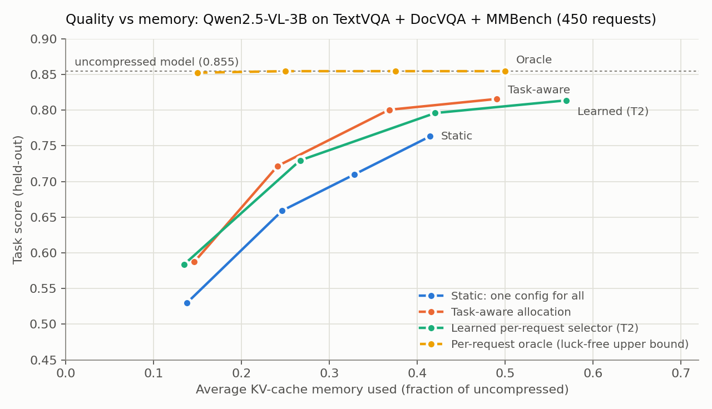
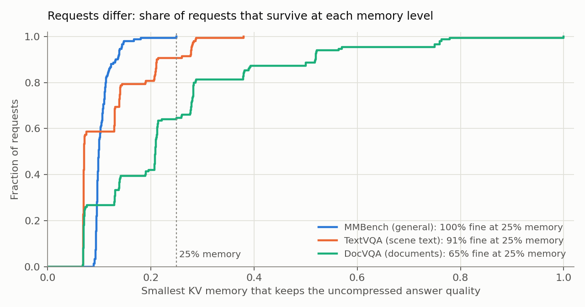
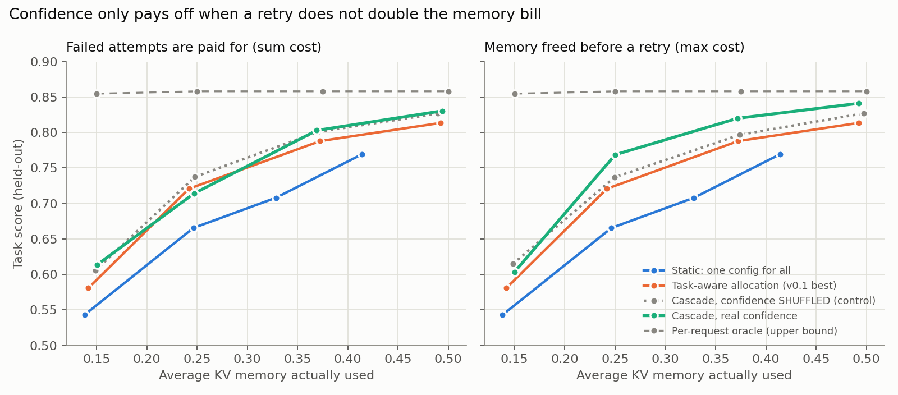
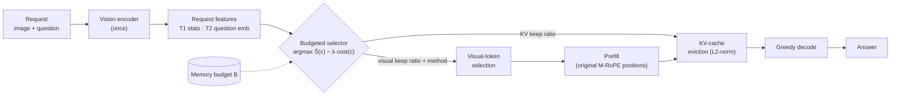

<div align="center">

# UniInfer

**Request-adaptive inference budgets for vision-language models**

*Not every request needs the same memory. UniInfer measures how much each request can be compressed,
then learns to spend a fixed memory budget where it matters.*

[](https://github.com/Rakshitha-Ireddi/UniInfer/actions/workflows/ci.yml)
[](LICENSE)


[Results](#results-v01) · [v0.2](#results-v02-confidence-cascades) · [How it works](#how-it-works) · [Quickstart](#quickstart) · [Reproduce](#reproduce-the-paper-numbers) · [Roadmap](ROADMAP.md) · [Design decisions](docs/adr/README.md) · [Contributing](CONTRIBUTING.md)

</div>

---

## Why

Vision-language models spend most of their input on **visual tokens**: 391 of 430 input tokens for a single
640×480 image in Qwen2.5-VL. Every one of them occupies **KV-cache memory** for the whole generation.
Existing work compresses visual tokens or the KV cache **by a fixed ratio for every request**.

But requests differ. *"What colour is the car?"* survives aggressive compression. *"What is the total on
line 14 of this invoice?"* does not. UniInfer asks:

> **Under a fixed memory budget, can choosing compression per request beat the best one-size-fits-all
> setting, and can a cheap predictor make that choice before answering?**

## Results (v0.1)

Qwen2.5-VL-3B · 450 requests (150 each from TextVQA, DocVQA and MMBench) · 28 compression configs per request
(visual-token keep ratio × pruning method × KV-cache keep ratio) · all numbers held-out (5-fold CV × 3 seeds).

<picture>
  <source media="(prefers-color-scheme: dark)" srcset="docs/figures/quality_vs_memory_dark.png">
  
</picture>

**Finding 1: the headroom is large.** A per-request oracle keeps **full quality (0.855) at 15% of the KV
memory**. The best single static config scores 0.536 at that budget. This is a luck-free upper bound:
no credit is given when a compressed config beats the uncompressed model.

**Finding 2: requests differ, and by task.** At 25% memory, every MMBench request and 91% of TextVQA
requests keep their full-quality answer, but only 65% of DocVQA requests do.

<picture>
  <source media="(prefers-color-scheme: dark)" srcset="docs/figures/request_sensitivity_dark.png">
  
</picture>

**Finding 3: cheap learned selection recovers part of the gap, but not yet from per-request signals.**

| Avg. KV budget | Static | Task-aware | Learned T1 (1.4 ms) | Learned T2 | Learned T3 (+91 ms) | Oracle (raw) |
|:-:|:-:|:-:|:-:|:-:|:-:|:-:|
| 50% | 0.763 | 0.816 | **0.819** | 0.814 | 0.821 | 0.909 |
| 37.5% | 0.710 | **0.800** | 0.798 | 0.796 | 0.792 | 0.909 |
| 25% | 0.659 | 0.722 | 0.719 | **0.730** | 0.732 | 0.909 |
| 15% | 0.530 | 0.587 | **0.600** | 0.584 | 0.575 | 0.903 |

<sub>Mean over 3 seeds (std ≤ 0.014). Learned selectors overshoot the budget by 1–7 points of memory; the
figure plots realized cost. T1 = image/visual-token statistics plus question-text features, T2 = +
question embedding, T3 = + hidden state from a full prefill. Full tables:
[`results/v0.1-oracle/`](results/v0.1-oracle/).</sub>

Learned selection gains **+6 to +9 points over static**, but a selector that sees **only the task label**
does about as well. Most of today's gain comes from moving memory *between task types*. Closing the
remaining gap to the oracle with *per-request* signals is the open research problem, and it drives
[v0.2](ROADMAP.md).

## Results (v0.2): confidence cascades

Can the model's own confidence tell us *which* requests a cheap config damaged? Answer cheaply, and
escalate to a larger budget only when unsure. Full write-up:
[`experiments/cascade/`](experiments/cascade/README.md).

<picture>
  <source media="(prefers-color-scheme: dark)" srcset="docs/figures/cascade_frontier_dark.png">
  
</picture>

**Finding 4: the per-request signal exists.** The minimum token log-prob of the answer separates kept
answers from damaged ones with **AUROC 0.85**. First-token confidence, the usual cascade signal, is at
chance on DocVQA (0.49).

**Finding 5: but it does not pay for itself when retries cost double.** A per-task cascade beats task-aware
allocation at 15% memory (+3.3 points, 95% CI [+1.1, +5.6]). However, **the same cascade with confidence
shuffled across requests does just as well**. The gain comes from mixing two configs per task, not from
the signal.

**Finding 6: confidence pays off once a retry is cheap.** If the cheap attempt's memory is freed before
the retry, real confidence beats the shuffled control by **+1.4 to +3.2 points** at 3 of 4 budgets
(paired bootstrap CIs exclude 0), and beats task-aware allocation by up to +4.8. The bottleneck is
*escalation cost*, which makes cheap re-compression of a retained cache a v0.3 serving problem.

### What compression looks like on one request

```text
visual 100%  kv 100%  ->  "...a red square and a blue circle. The invoice total ... is $482.17."
visual  50%  kv 100%  ->  "...a red square and a blue circle. The invoice total ... is $482.17."
visual  50%  kv  50%  ->  "...a red circle and a blue circle. The invoice total ... is $4."
visual  25%  kv  25%  ->  "The image shows a handwritten note with the following details:"
```

## How it works



| Component | Module | Notes |
|---|---|---|
| Runtime | [`uniinfer.runtime.QwenVLRunner`](src/uniinfer/runtime/qwen25vl.py) | Own prefill/decode loop that keeps M-RoPE positions correct after pruning; **token-identical to HF `generate()`** when uncompressed ([ADR-0003](docs/adr/0003-custom-prefill-decode-loop.md)) |
| Visual tokens | [`uniinfer.compression.select_visual_tokens`](src/uniinfer/compression/visual_tokens.py) | `uniform`, `dissim` (drop redundant/background patches) |
| KV cache | [`uniinfer.compression.compress_kv_l2norm`](src/uniinfer/compression/kv_cache.py) | Attention-free L2-norm eviction; keeps sinks and question tail |
| Selector | [`uniinfer.controller.BudgetedSelector`](src/uniinfer/controller/selector.py) | Gradient-boosted quality predictor plus Lagrangian budget allocation ([ADR-0005](docs/adr/0005-cost-model-and-budgeted-selection.md)) |
| Cascade | [`uniinfer.controller.fit_group_cascades`](src/uniinfer/controller/cascade.py) | Per-task confidence cascades under one shared budget ([ADR-0008](docs/adr/0008-confidence-cascade.md)) |
| Metrics | [`uniinfer.metrics`](src/uniinfer/metrics.py) | VQA accuracy, ANLS, multiple-choice accuracy |

## Quickstart

Requires an NVIDIA GPU with at least 10 GB free. Tested on RTX A5000 and RTX 3090.

```bash
git clone https://github.com/Rakshitha-Ireddi/UniInfer.git && cd UniInfer
UNIINFER_WORK=/path/to/big/disk bash scripts/setup_env.sh   # no root or conda needed
source /path/to/big/disk/env.sh
python scripts/smoke_test.py
```

```python
from PIL import Image
from uniinfer.runtime import QwenVLRunner

r = QwenVLRunner()  # Qwen/Qwen2.5-VL-3B-Instruct
img = Image.open("receipt.png")
r.run(img, "What is the total?", v_ratio=0.5, v_method="dissim", kv_ratio=0.5)
```

## Reproduce the paper numbers

Every number above is regenerated from committed raw results. The CPU-only steps take minutes:

```bash
pip install -e ".[experiments]"
python experiments/oracle/analyze.py        # oracle vs static vs per-task  (CPU, seconds)
python experiments/oracle/predictor.py      # learned selectors, 5-fold CV  (CPU, minutes)
python experiments/oracle/make_figures.py   # README figures
```

Regenerate the raw results on a GPU (about 25 min for the sweep, 3 min for features, on one A5000):

```bash
python experiments/oracle/sweep.py --check   # correctness gate: must print EQUIVALENCE PASS
python experiments/oracle/sweep.py --n 150   # 450 requests x 28 configs -> oracle_sweep.jsonl
python experiments/oracle/features.py        # request features -> features.npz
```

The method and protocol are in [`experiments/oracle/README.md`](experiments/oracle/README.md) and
[ADR-0006](docs/adr/0006-evaluation-protocol.md).

## Repository layout

```text
src/uniinfer/          installable library
  runtime/             Qwen2.5-VL runner with explicit prefill / compress / decode
  compression/         visual-token selection, KV-cache eviction
  controller/          budgeted per-request config selection
  metrics.py data.py   task metrics, benchmark loaders and prompts
experiments/oracle/    v0.1 study: sweep -> features -> analyze -> predictor -> figures
experiments/cascade/   v0.2 study: confidence cascades, shuffled control, paired tests
results/v0.1-oracle/   committed raw results + reports (reproducible on CPU)
results/v0.2-cascade/  same requests + per-config confidence
docs/adr/              architecture decision records
docs/figures/          README figures (light + dark)
scripts/               environment setup, smoke test
tests/                 CPU unit tests (run in CI)
```

## Limitations (read before citing)

- One model (Qwen2.5-VL-3B), 150 requests per dataset, greedy decoding, batch size 1.
- Compression operators are simple placeholders. FastV, SparseVLM, SnapKV and PyramidKV baselines come
  next ([ADR-0004](docs/adr/0004-compression-operators.md)).
- Cost is relative KV memory. At batch 1 the weights dominate peak VRAM, so the memory benefit has to be
  shown under concurrent serving or long contexts (v0.3).
- Latency was measured on shared GPUs and is diagnostic only.

## Roadmap

| Version | Theme | Status |
|---|---|---|
| **v0.1** | Oracle study plus first learned selector | ✅ released |
| **v0.2** | Close the oracle gap with per-request signals; strong baselines; second VLM | 🚧 cascade study done |
| **v0.3** | Serving: batched decode with heterogeneous budgets, vLLM integration, throughput under memory caps | 📋 planned |
| **v0.4** | Compression foundation: INT4/INT8 weights (AWQ/GPTQ), KV quantization, Triton kernels | 📋 planned |
| **v1.0** | Benchmark suite plus paper | 📋 planned |

Details, open research questions and good first issues: **[ROADMAP.md](ROADMAP.md)**.

## Contributing

Ideas, experiments, new compression operators, new models and critiques are all welcome. Start with
[CONTRIBUTING.md](CONTRIBUTING.md), browse issues labelled
[`good first issue`](https://github.com/Rakshitha-Ireddi/UniInfer/labels/good%20first%20issue), or open a
[research idea](https://github.com/Rakshitha-Ireddi/UniInfer/issues/new?template=research_idea.md).

## Citation

```bibtex
@software{uniinfer2026,
  author = {Ireddi, Rakshitha},
  title  = {UniInfer: Request-Adaptive Inference Budgets for Vision-Language Models},
  year   = {2026},
  url    = {https://github.com/Rakshitha-Ireddi/UniInfer},
  version = {0.1.0}
}
```

## Acknowledgements

Built on [Qwen2.5-VL](https://github.com/QwenLM/Qwen2.5-VL), [Hugging Face Transformers](https://github.com/huggingface/transformers)
and the [lmms-lab](https://huggingface.co/lmms-lab) evaluation datasets. KV eviction follows Devoto et al.,
*A Simple and Effective L2 Norm-Based Strategy for KV Cache Compression* (2024).

Licensed under [Apache-2.0](LICENSE).
