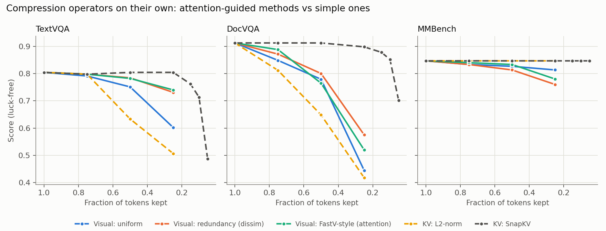
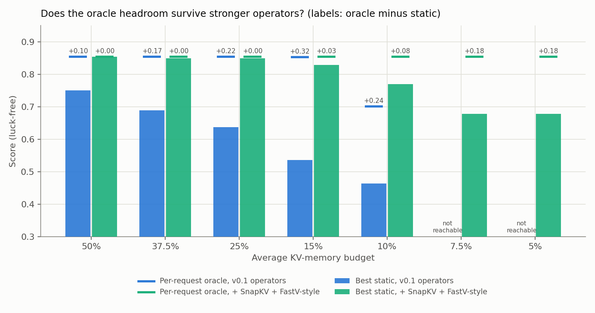
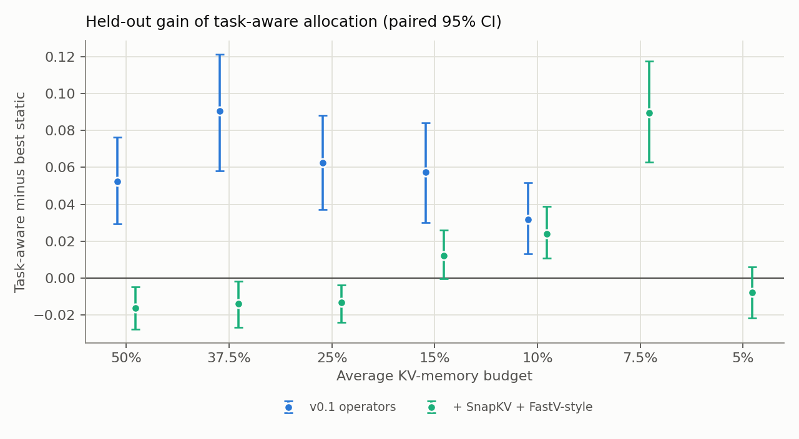

# Experiment: does the headroom survive stronger operators? (v0.2 baselines)

**Question.** v0.1 found a large gap between the best *static* compression config and a per-request oracle,
but with simple operators (uniform or redundancy visual pruning, L2-norm KV eviction). If a stronger static
operator closes most of that gap, per-request allocation matters much less. This experiment gives the static
baseline the standard attention-guided operators and measures again.

**Short answer.** Mostly, yes. SnapKV keeps almost full quality down to 25% of the KV cache, which removes
the v0.1 headroom at 25% memory and above. Headroom remains at tight budgets (10% and below), and task-aware
allocation only pays off there.

## Operators

| Axis | Operator | What it keeps | Source |
|---|---|---|---|
| Visual | `uniform` | evenly spaced patches | v0.1 |
| Visual | `dissim` | patches least similar to the image mean (drops background/redundancy) | v0.1 |
| Visual | **`attn`** | patches with the highest attention from the question window at layer 2 (**FastV-style**) | new |
| KV | `l2norm` | lowest-norm keys + sinks + question tail (Devoto et al., 2024) | v0.1 |
| KV | **`snapkv`** | per layer and KV head: top pooled attention from the question window + the window (**SnapKV**) | new |

Both new operators need attention weights, which SDPA does not return. We rebuild exactly the rows we need
from captured queries and cached keys (see [ADR-0009](../../docs/adr/0009-attention-guided-baselines.md)).
`sweep.py --check-attn` verifies the reconstruction against the model's own attention output at every layer
(worst relative error 1.2%, i.e. BF16 noise; a wrong query, RoPE or mask would give errors near 100%).

**Deviation from FastV:** FastV prunes inside the forward pass after layer 2. We prune *before* prefill so that
every layer's KV shrinks and the cost model stays "relative KV memory". The scores come from layers 0–2.

## Pipeline

| Step | Command | Needs | Output |
|---|---|---|---|
| 0 | `python experiments/oracle/sweep.py --check` and `--check-attn` | GPU | `EQUIVALENCE PASS`, `ATTENTION PASS` |
| 1 | `python experiments/oracle/sweep.py --n 150 --v-methods uniform,dissim,attn --kv-methods l2norm,snapkv --out results/v0.2-baselines/oracle_sweep.jsonl` | GPU, about 1 h | same 450 requests, **70 configs** each |
| 2 | `python experiments/oracle/sweep.py --n 150 --v-methods uniform,dissim,attn --kv-methods snapkv --kv-ratios 1.0,0.15,0.1,0.05 --out results/v0.2-baselines-low/oracle_sweep.jsonl` | GPU, about 35 min | **30 more configs** at low SnapKV ratios |
| 3 | `python experiments/baselines/analyze.py --extra results/v0.2-baselines-low/oracle_sweep.jsonl --out results/v0.2-baselines-low/baselines_results.json` | CPU, about 2 min | merged 100-config analysis, budgets 50% down to 5% |
| 4 | `python experiments/baselines/make_figures.py` | CPU | `docs/figures/{operators,headroom_operators,allocation_operators}_*.png` |

Running `analyze.py` without `--extra` gives the 70-config analysis (budgets 50%–15%) in
`results/v0.2-baselines/`. Both sweeps ran on an RTX A5000. Every prediction they share with v0.1 is
identical (12600 / 12600), as is every prediction the two new sweeps share (4500 / 4500).

## Results

450 requests (150 each from TextVQA, DocVQA, MMBench), Qwen2.5-VL-3B, 100 configs per request. Scores are
luck-free (capped at the uncompressed score) unless marked. CIs are 95% stratified request bootstraps
(2000 replicates). Full output: [`results/v0.2-baselines-low/baselines_analysis.txt`](../../results/v0.2-baselines-low/baselines_analysis.txt).

### 1. SnapKV is far stronger than every v0.1 operator

<picture>
  <source media="(prefers-color-scheme: dark)" srcset="../../docs/figures/operators_dark.png">
  
</picture>

| Fraction kept | KV: L2-norm | KV: SnapKV | Visual: uniform | Visual: dissim | Visual: FastV-style |
|:-:|:-:|:-:|:-:|:-:|:-:|
| 75% | 0.819 | **0.852** | 0.824 | 0.834 | 0.842 |
| 50% | 0.709 | **0.855** | 0.786 | 0.799 | 0.793 |
| 25% | 0.590 | **0.850** | 0.620 | 0.689 | 0.680 |
| 15% | | 0.829 | | | |
| 10% | | 0.804 | | | |
| 5% | | 0.679 | | | |

Uncompressed: 0.855. SnapKV is lossless to 50% and loses 0.005 at 25%; below 10% it falls off, mostly on
TextVQA (0.487 at 5%) and DocVQA (0.702). **MMBench is untouched even at 5% KV** (0.847): the answer is a
letter, and the options sit in the observation window that SnapKV always keeps. FastV-style pruning helps
only at mild pruning (75%) and is not better than redundancy pruning below that.

### 2. The headroom largely disappears, except at tight budgets

<picture>
  <source media="(prefers-color-scheme: dark)" srcset="../../docs/figures/headroom_operators_dark.png">
  
</picture>

| Avg. KV budget | v0.1 operators: static → oracle (gap) | All operators: static → oracle (gap, 95% CI) | Best static config (all operators) |
|:-:|:-:|:-:|:-:|
| 50% | 0.750 → 0.855 (+0.104) | 0.855 → 0.855 (+0.000) | SnapKV 50% |
| 37.5% | 0.689 → 0.855 (+0.166) | 0.850 → 0.855 (+0.005 [+0.001, +0.009]) | SnapKV 25% |
| 25% | 0.638 → 0.855 (+0.217) | 0.850 → 0.855 (+0.005 [+0.002, +0.027]) | SnapKV 25% |
| 15% | 0.536 → 0.852 (+0.316) | 0.829 → 0.855 (+0.026 [+0.015, +0.061]) | SnapKV 15% |
| 10% | 0.465 → 0.701 (+0.236) | 0.770 → 0.855 (**+0.085** [+0.038, +0.105]) | FastV-style 75% + SnapKV 10% |
| 7.5% | not reachable | 0.679 → 0.855 (**+0.176** [+0.146, +0.207]) | SnapKV 5% |
| 5% | not reachable | 0.679 → 0.855 (**+0.176** [+0.146, +0.209]) | SnapKV 5% |

Most of the v0.1 headroom at 25% memory and above came from L2-norm eviction being weak, not from requests
needing different budgets. The oracle stays at full quality all the way down to 5%, because many requests
(all of MMBench) need almost no KV, so their memory can go to fragile requests. That is where per-request
allocation still has room: **at 10% memory and below, the gap is 0.085 to 0.176**.

### 3. Held-out task-aware allocation only helps at tight budgets

<picture>
  <source media="(prefers-color-scheme: dark)" srcset="../../docs/figures/allocation_operators_dark.png">
  
</picture>

Raw scores, 5-fold CV × 3 seeds; difference is a paired stratified bootstrap over requests.

| Avg. KV budget | Static | Per-task static | Task-aware | Task-aware − static (95% CI) |
|:-:|:-:|:-:|:-:|:-:|
| 50% | 0.858 | 0.854 | 0.842 | −0.016 [−0.028, −0.005] |
| 37.5% | 0.850 | 0.844 | 0.836 | −0.014 [−0.027, −0.002] |
| 25% | 0.849 | 0.846 | 0.836 | −0.013 [−0.024, −0.004] |
| 15% | 0.816 | 0.824 | 0.829 | +0.012 [−0.000, +0.026] |
| 10% | 0.776 | 0.772 | 0.800 | **+0.024 [+0.011, +0.039]** |
| 7.5% | 0.685 | 0.740 | 0.775 | **+0.089 [+0.063, +0.117]** |
| 5% | 0.685 | 0.667 | 0.678 | −0.008 [−0.022, +0.006] |

With v0.1 operators, task-aware allocation beat static by +0.032 to +0.091 at every budget. With SnapKV
available, it is slightly **worse** than one static config at 25% memory and above: there is no gap left to
win, and the selector's estimation error costs about 1.5 points. It wins at 10% and 7.5%. The 7.5% gain
partly reflects the grid: no single config costs between 5% and 10%, so static drops to SnapKV 5%
(realized cost 0.05) while task-aware mixes configs (0.07). At 5% there is nothing cheaper to mix with, and
the gain vanishes.

## What this changes

- **The v0.1 headroom numbers are an upper bound for weak operators.** Any claim about per-request budgets
  must be made against SnapKV-class baselines, and in the regime where they break (≤10% KV here).
- **The research question moves to extreme compression.** Per-request signals (v0.2 cascades, probes) should
  be re-evaluated at 10%, 7.5% and 5% with SnapKV in the grid. Finer KV ratios (5–10%) would remove the
  grid effect at 7.5%.
- **Cheap escalation (v0.3) gets easier.** SnapKV re-compression of a retained cache is cheap, so a cascade
  can retry at a larger SnapKV ratio without a new prefill.

## Caveats

- One model (Qwen2.5-VL-3B), 150 requests per dataset, short answers. SnapKV's window keeps the whole
  question, which favours short-answer VQA; long-form generation may behave differently.
- FastV-style pruning is a pre-prefill variant (see above), not exact FastV.
- Cost is relative KV memory. SnapKV and FastV-style scoring add compute that this cost model does not count.
