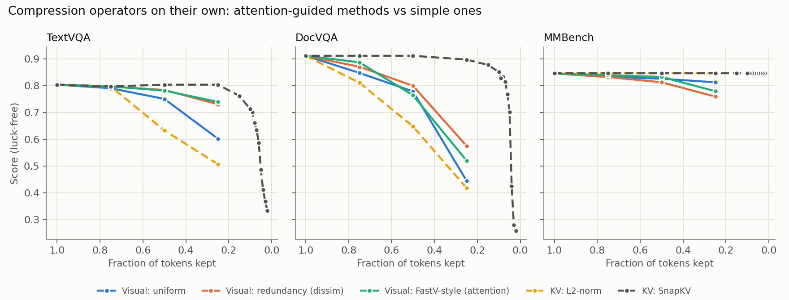
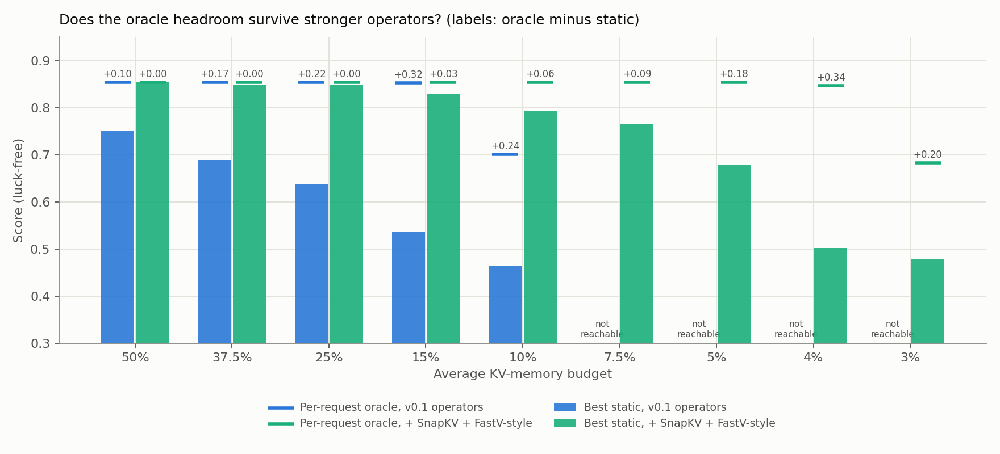
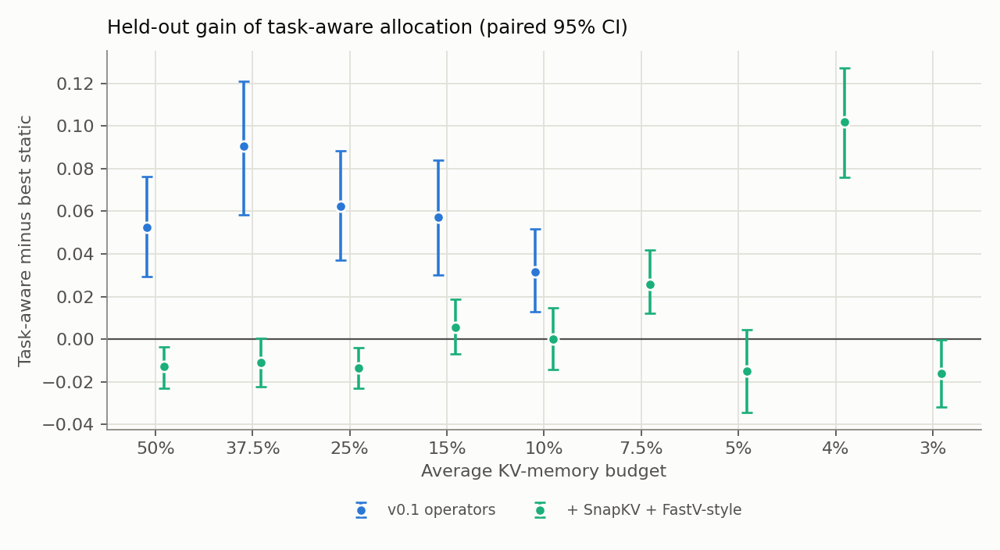
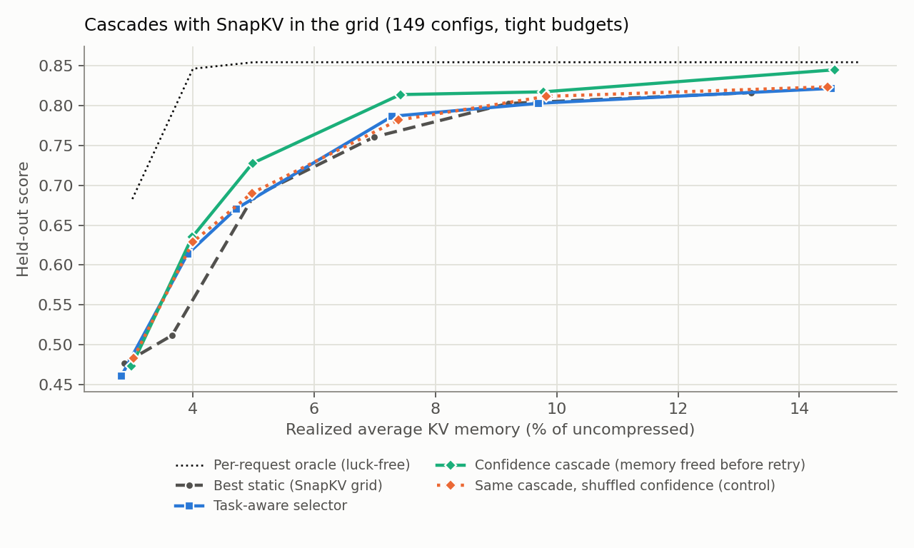

# Experiment: does the headroom survive stronger operators? (v0.2 baselines)

**Question.** v0.1 found a large gap between the best *static* compression config and a per-request oracle,
but with simple operators (uniform or redundancy visual pruning, L2-norm KV eviction). If a stronger static
operator closes most of that gap, per-request allocation matters much less. This experiment gives the static
baseline the standard attention-guided operators and measures again.

**Short answer.** At moderate budgets, yes: SnapKV keeps almost full quality down to 25% of the KV cache and
removes the v0.1 headroom there. But SnapKV has a **cliff between 5% and 4% of the KV cache**, and the
headroom comes back around it (+0.18 at 5%, +0.34 at 4%). In that regime, task-aware allocation gains up to
+0.10, and a confidence cascade beats its shuffled-confidence control when a retry does not have to pay
twice.

## Operators

| Axis | Operator | What it keeps | Source |
|---|---|---|---|
| Visual | `uniform` | evenly spaced patches | v0.1 |
| Visual | `dissim` | patches least similar to the image mean (drops background/redundancy) | v0.1 |
| Visual | **`attn`** | patches with the highest attention from the question window at layer 2 (**FastV-style**) | new |
| KV | `l2norm` | lowest-norm keys + sinks + question tail (Devoto et al., 2024) | v0.1 |
| KV | **`snapkv`** | per layer and KV head: top pooled attention from the question window + the window (**SnapKV**) | new |
| KV | **`pyramid`** | SnapKV selection with more tokens in lower layers, same average (**PyramidKV**, β = 20) | new |

The attention-guided operators need attention weights, which SDPA does not return. We rebuild exactly the
rows we need from captured queries and cached keys (see
[ADR-0009](../../docs/adr/0009-attention-guided-baselines.md)). `sweep.py --check-attn` verifies the
reconstruction against the model's own attention output at every layer (worst relative error 1.2%, i.e.
BF16 noise; a wrong query, RoPE or mask would give errors near 100%).

**Deviation from FastV:** FastV prunes inside the forward pass after layer 2. We prune *before* prefill so that
every layer's KV shrinks and the cost model stays "relative KV memory". The scores come from layers 0–2.

**Cost of PyramidKV:** layers hold different numbers of tokens, so cost is the KV length averaged over
layers (`kv_tokens`). This equals the old per-layer length for every other operator.

## Pipeline

All sweeps cover the same 450 requests (150 each from TextVQA, DocVQA, MMBench; Qwen2.5-VL-3B) and run
`--check` and `--check-attn` first.

| Step | Command (`sweep.py` = `python experiments/oracle/sweep.py --n 150`) | GPU time | Output |
|---|---|---|---|
| 1 | `sweep.py --v-methods uniform,dissim,attn --kv-methods l2norm,snapkv --out results/v0.2-baselines/oracle_sweep.jsonl` | about 1 h | 70 configs |
| 2 | `sweep.py --v-methods uniform,dissim,attn --kv-methods snapkv --kv-ratios 1.0,0.15,0.1,0.05 --out results/v0.2-baselines-low/oracle_sweep.jsonl` | about 35 min | +30 configs |
| 3 | `sweep.py --v-methods dissim,attn --kv-methods snapkv --kv-ratios 1.0,0.09,0.08,0.07,0.06,0.04,0.03,0.02 --out results/v0.2-baselines-fine/oracle_sweep.jsonl` | about 1 h | +49 configs |
| 4 | `sweep.py --v-methods attn --kv-methods pyramid --kv-ratios 1.0,0.25,0.15,0.1,0.05 --out results/v0.2-pyramid/oracle_sweep.jsonl` | about 1.2 h | PyramidKV, 20 configs |

CPU analysis (merges the sweeps; `merged_sweep*.jsonl` is rebuilt on every run and not committed):

```bash
E="results/v0.2-baselines-low/oracle_sweep.jsonl results/v0.2-baselines-fine/oracle_sweep.jsonl"
python experiments/baselines/analyze.py --extra $E --budgets 0.5,0.375,0.25,0.15,0.1,0.075,0.05,0.04,0.03,0.02 \
    --out results/v0.2-baselines-fine/baselines_results.json          # about 3 min
python experiments/baselines/cascade_snapkv.py --extra $E --budgets 0.15,0.1,0.075,0.05,0.04,0.03 \
    --out results/v0.2-baselines-fine/cascade_snapkv                   # about 10 min
python experiments/baselines/make_figures.py
```

The three SnapKV sweeps ran on RTX A5000s. Every prediction they share with v0.1 is identical
(12600 / 12600), and so is every prediction they share with each other.

## Results

149 configs per request. Scores are luck-free (capped at the uncompressed score) unless marked. CIs are 95%
stratified request bootstraps (2000 replicates). Full output:
[`results/v0.2-baselines-fine/`](../../results/v0.2-baselines-fine/).

### 1. SnapKV is far stronger than every v0.1 operator, until a cliff at about 5%

<picture>
  <source media="(prefers-color-scheme: dark)" srcset="../../docs/figures/operators_dark.png">
  
</picture>

| KV kept | L2-norm | **SnapKV** (all) | SnapKV DocVQA | SnapKV TextVQA | SnapKV MMBench |
|:-:|:-:|:-:|:-:|:-:|:-:|
| 75% | 0.819 | 0.852 | 0.912 | 0.798 | 0.847 |
| 25% | 0.590 | 0.850 | 0.898 | 0.804 | 0.847 |
| 15% | | 0.829 | 0.878 | 0.762 | 0.847 |
| 10% | | 0.804 | 0.852 | 0.713 | 0.847 |
| 7% | | 0.766 | 0.815 | 0.636 | 0.847 |
| 5% | | 0.679 | 0.702 | 0.487 | 0.847 |
| **4%** | | **0.561** | **0.425** | 0.411 | 0.847 |
| 2% | | 0.479 | 0.258 | 0.333 | 0.847 |

Uncompressed: 0.855 (DocVQA 0.912, TextVQA 0.804, MMBench 0.847). L2-norm loses 0.27 at 25%; SnapKV loses
0.005. DocVQA collapses between 5% and 4% of the KV cache. **MMBench is untouched even at 2%**: the answer is
a letter, and the options sit in the observation window that SnapKV always keeps. Visual-token pruning
(FastV-style or not) costs more than SnapKV at every matched ratio; FastV-style beats uniform and redundancy
pruning only at 75% kept (0.842 vs 0.824 and 0.834).

### 2. The headroom disappears at moderate budgets and comes back around the cliff

<picture>
  <source media="(prefers-color-scheme: dark)" srcset="../../docs/figures/headroom_operators_dark.png">
  
</picture>

| Avg. KV budget | v0.1 operators: static → oracle (gap) | All operators: static → oracle (gap, 95% CI) | Best static config |
|:-:|:-:|:-:|:-:|
| 50% | 0.750 → 0.855 (+0.104) | 0.855 → 0.855 (+0.000) | SnapKV 50% |
| 25% | 0.638 → 0.855 (+0.217) | 0.850 → 0.855 (+0.005 [+0.002, +0.027]) | SnapKV 25% |
| 15% | 0.536 → 0.852 (+0.316) | 0.829 → 0.855 (+0.026 [+0.015, +0.061]) | SnapKV 15% |
| 10% | 0.465 → 0.701 (+0.236) | 0.793 → 0.855 (+0.062 [+0.038, +0.082]) | SnapKV 9% |
| 7.5% | not reachable | 0.766 → 0.855 (+0.089 [+0.065, +0.112]) | SnapKV 7% |
| 5% | not reachable | 0.679 → 0.855 (**+0.176** [+0.146, +0.210]) | SnapKV 5% |
| 4% | not reachable | 0.502 → 0.846 (**+0.344** [+0.282, +0.366]) | FastV-style 75% + SnapKV 4% |
| 3% | not reachable | 0.479 → 0.683 (+0.203 [+0.153, +0.217]) | SnapKV 2% |

(37.5%: +0.005; 2%: no config is that cheap.) Most of the v0.1 headroom at 15% memory and above came from
L2-norm eviction being weak, not from requests needing different budgets. The oracle keeps full quality down
to 5%, because many requests (all of MMBench) need almost no KV, so their memory can go to fragile requests.
The gap peaks right at SnapKV's cliff.

### 3. Held-out task-aware allocation pays off only near the cliff

<picture>
  <source media="(prefers-color-scheme: dark)" srcset="../../docs/figures/allocation_operators_dark.png">
  
</picture>

Raw scores, 5-fold CV × 3 seeds; the difference is a paired stratified bootstrap over requests.

| Avg. KV budget | Static | Per-task static | Task-aware | Task-aware − static (95% CI) |
|:-:|:-:|:-:|:-:|:-:|
| 50% | 0.858 | 0.854 | 0.845 | −0.013 [−0.023, −0.004] |
| 25% | 0.849 | 0.846 | 0.836 | −0.013 [−0.023, −0.004] |
| 15% | 0.816 | 0.824 | 0.822 | +0.005 [−0.007, +0.019] |
| 10% | 0.803 | 0.788 | 0.803 | +0.000 [−0.014, +0.015] |
| 7.5% | 0.761 | 0.770 | 0.787 | +0.026 [+0.012, +0.042] |
| 5% | 0.685 | 0.673 | 0.671 | −0.015 [−0.034, +0.005] |
| **4%** | 0.512 | 0.565 | **0.614** | **+0.102 [+0.076, +0.127]** |
| 3% | 0.477 | 0.496 | 0.461 | −0.016 [−0.032, −0.000] |

With v0.1 operators, task-aware allocation beat static by +0.03 to +0.09 at every budget. With SnapKV, it is
about 1.3 points **worse** than one static config at 25% memory and above (no gap to win; estimation error
costs a little) and **+0.102 better at 4%**. The mechanism is simple: MMBench is moved to about 2% KV, which
lets DocVQA and TextVQA stay above the cliff at about 5%. An earlier, coarser grid (5% steps) suggested
gains at 10% and 7.5% of +0.024 and +0.089; with 1-point steps these shrink to +0.000 and +0.026, so they
were mostly grid effects. We report the fine grid.

### 4. Confidence cascades with SnapKV in the grid

The baseline sweeps log the same confidence signals as the v0.2 cascade study, so the cascades can be re-run
on the 149-config grid on a CPU (`cascade_snapkv.py`). The signal is fixed in advance: the answer's minimum
token log-prob, the best signal in v0.2.

<picture>
  <source media="(prefers-color-scheme: dark)" srcset="../../docs/figures/cascade_snapkv_dark.png">
  
</picture>

**The signal still works.** AUROC for "this config keeps the uncompressed score" is 0.828 over SnapKV configs
at ≤15% KV (L2-norm configs: 0.855); it is lowest on TextVQA (0.703).

| Avg. KV budget | 15% | 10% | 7.5% | 5% | 4% | 3% |
|---|:-:|:-:|:-:|:-:|:-:|:-:|
| Static | 0.816 | 0.803 | 0.761 | 0.685 | 0.512 | 0.477 |
| Task-aware selector | 0.822 | 0.803 | 0.787 | 0.671 | 0.614 | 0.461 |
| Cascade, memory freed before retry | **0.845** | **0.817** | **0.814** | **0.728** | **0.635** | 0.473 |
| Same, shuffled confidence | 0.824 | 0.812 | 0.782 | 0.690 | 0.629 | 0.483 |
| **Real − shuffled** (95% CI) | **+0.021** [+0.007, +0.035] | +0.006 [−0.008, +0.019] | **+0.032** [+0.015, +0.048] | **+0.037** [+0.019, +0.055] | +0.006 [−0.009, +0.020] | −0.010 [−0.027, +0.007] |
| Cascade − task-aware selector | +0.023 [+0.008, +0.039] | +0.014 [−0.004, +0.032] | +0.027 [+0.008, +0.046] | +0.057 [+0.036, +0.077] | +0.021 [+0.003, +0.039] | +0.013 [−0.008, +0.032] |

When the cheap attempt's memory is freed before the retry, which SnapKV makes natural (re-compress the
retained prefill KV at a larger ratio), **real confidence beats the shuffled control at 3 of 6 budgets by +2
to +4 points**. All three survive a Holm correction over the six budgets (one-sided bootstrap P ≤ 0.002).
At 5% the cascade reaches 0.728, against 0.685 for static and 0.671 for task-aware allocation. When a failed
attempt is paid in full, real and shuffled confidence are mixed (+0.018 at 15%, +0.011 at 3%, −0.019 at 5%),
which matches the v0.2 finding that escalation cost is the bottleneck. Full output:
[`cascade_snapkv.txt`](../../results/v0.2-baselines-fine/cascade_snapkv.txt).

### 5. PyramidKV

*Pending: the sweep is running.* On the first 64 TextVQA requests, PyramidKV is clearly below SnapKV at the
same average memory (e.g. 0.542 vs 0.693 raw at 15%). A unit test confirms that a flat pyramid (β = 1)
reproduces SnapKV exactly, so the difference comes from the per-layer budget split.

## What this changes

- **The v0.1 headroom numbers are an upper bound for weak operators.** Per-request claims must be made
  against SnapKV-class baselines, near their cliff (about 4–7% KV here).
- **The useful per-request signal is real but small, and it needs cheap escalation.** That is the v0.3
  serving problem: keep the prefill KV, re-compress instead of re-running prefill, and free the cheap
  attempt's pages before the retry.
- **Insensitive requests fund fragile ones.** The biggest held-out gain (+0.102 at 4%) comes from moving
  memory away from MMBench. A detector for "this request needs almost no KV" may be worth more than a
  detector for fragile requests.

## Caveats

- One model (Qwen2.5-VL-3B), 150 requests per dataset, short answers. SnapKV's window keeps the whole
  question, which favours short-answer VQA; long-form generation may behave differently.
- The cliff location depends on the observation window (16 tokens) and on prompt length. MMBench prompts are
  short and the options sit in the window.
- FastV-style pruning is a pre-prefill variant (see above), not exact FastV.
- Cost is relative KV memory. SnapKV and FastV-style scoring add compute that this cost model does not count.
- Many budgets and comparisons are reported. We give every one of them, with CIs, and fixed the confidence
  signal in advance.
