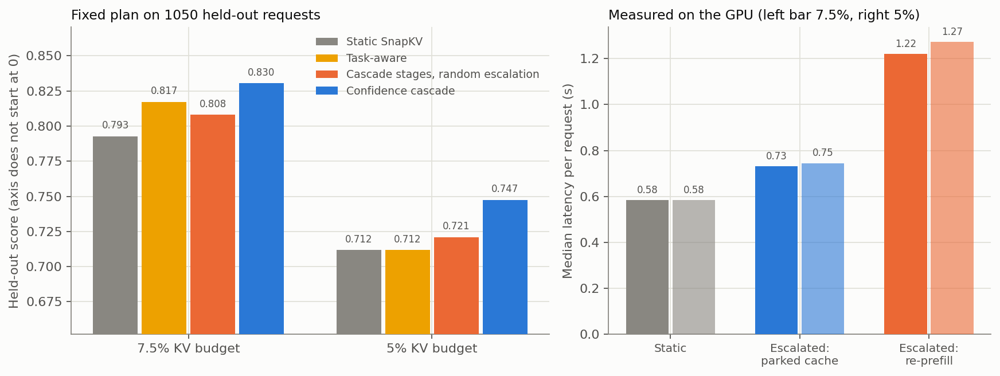

# Experiment: cheap escalation, end to end on new requests (v0.3 groundwork)

**Question.** On the SnapKV grid, a confidence cascade beats its shuffled control only if a retry does not
pay for the failed attempt, and request features cannot replace the cheap answer's confidence (see
[`experiments/baselines/`](../baselines/README.md), sections 4 and 6). Can a real system make the retry
cheap, and does the cascade's gain hold up on requests it has never seen?

**Method** ([ADR-0010](../../docs/adr/0010-cheap-escalation.md)). Cascades vary only the SnapKV ratio (all
visual tokens kept), so both stages come from **one prefill**. The stage-2 cache is parked in pinned CPU
memory, the stage-1 cache is decoded, and on low confidence (the answer's min token log-prob) stage 1 is
freed and stage 2 is copied back. The naive alternative re-runs encode and prefill on a retry. Both return
exactly the single-config answers (`run.py --check`), so only cost and latency differ.

## Pipeline

| Step | Command | Needs | Output (`results/v0.3-escalation/`) |
|---|---|---|---|
| 1 | `python experiments/escalation/plan.py` | CPU, about 2 min | `plan.json`: per-task cascades and the static SnapKV ratio at 7.5% and 5%, fit on the 450 v0.2 requests |
| 2 | `python experiments/escalation/run.py --check` | GPU | `ESCALATION PASS` |
| 3 | `python experiments/escalation/run.py --n 100` | GPU | `runs.jsonl`: 100 **new** requests per dataset (shuffle seed 1, every v0.1/v0.2 request skipped) × {uncompressed, static, cascade + offload, cascade + re-prefill} × 2 budgets |
| 4 | `python experiments/escalation/analyze.py > results/v0.3-escalation/escalation_analysis.txt` | CPU | `escalation_analysis.txt`, `escalation_results.json` |
| 5 | `python experiments/escalation/transfer.py > results/v0.3-escalation/transfer.txt` | CPU, about 1 min | `transfer.txt`, `transfer.json`: the plan replayed on the 1050 held-out scale-sweep requests |
| 6 | `python experiments/escalation/figures.py` | CPU | `docs/figures/escalation_{light,dark}.png` |

## The plan (fit on the v0.2 requests)

KV-only grid: uncompressed plus SnapKV at 75–2% (14 configs). Cross-validated on the v0.2 requests:

| Budget | Static SnapKV | Per-task cascade | Same, shuffled confidence | Cascades chosen |
|:-:|:-:|:-:|:-:|---|
| 7.5% | 0.770 (7%) | 0.802 | 0.798 | DocVQA 7% → 15%, TextVQA 7% → 15%, MMBench 2% |
| 5% | 0.685 (5%) | 0.717 | 0.697 | DocVQA 5% → 7%, TextVQA 2% → 6%, MMBench 2% |

## Results

The plan was fixed before either evaluation below. Raw output: [`escalation_analysis.txt`](../../results/v0.3-escalation/escalation_analysis.txt)
(GPU run) and [`transfer.txt`](../../results/v0.3-escalation/transfer.txt) (replay).

<picture>
  <source media="(prefers-color-scheme: dark)" srcset="../../docs/figures/escalation_dark.png">
  
</picture>

### 1. End to end on 300 new requests (RTX A5000)

`--check` printed **ESCALATION PASS** before the run, and the offload and re-prefill modes returned identical
answers on all 300 × 2 requests.

| Budget | Static | Cascade | Cascade − static | Escalated | Realized KV (max / sum) |
|:-:|:-:|:-:|:-:|:-:|:-:|
| 7.5% | 0.836 | **0.867** | +0.031 [+0.016, +0.051] | 14% | 0.073 / 0.082 |
| 5% | 0.748 | **0.803** | +0.054 [+0.030, +0.080] | 31% | 0.049 / 0.058 |

**Escalation is cheap with a parked cache.** Parking the stage-2 cache costs about 1.5 ms per request, and
copying it back costs **1.1–1.4 ms**. Re-running encode and prefill costs **510–520 ms**. Escalated requests
take a median 0.73–0.75 s with the parked cache and 1.22–1.27 s with re-prefill (static: 0.58 s). Averaged
over all requests, the cascade adds 3–9% latency over static with the parked cache and 14–38% with
re-prefill. At most one stage's cache is on the GPU at a time (median 1.8–2.5 MB of KV); the parked copy
uses 2–5 MB of host memory. Timings come from a shared GPU and are diagnostic.

### 2. Which part of the gain is per-request? The plan on 1050 held-out requests

On the GPU run, "cascade − static" also includes task-aware allocation (the plan puts MMBench at 2% KV). The
scale sweep has every config the plan uses for 1050 TextVQA/DocVQA/MMBench requests outside v0.2. Escalation
returns exactly the single-config answers, so the plan can be replayed on them exactly. The replay matches
the GPU run on the 87 requests both contain: **348/348 answers and 174/174 escalation decisions**.

| Budget | Static | Task-aware | Same stages, random escalation | Cascade |
|:-:|:-:|:-:|:-:|:-:|
| 7.5% | 0.793 | 0.817 | 0.808 | **0.830** |
| 5% | 0.712 | 0.712 | 0.721 | **0.747** |

| Paired difference (95% CI) | 7.5% | 5% |
|---|:-:|:-:|
| cascade − static | +0.038 [+0.026, +0.049] | +0.036 [+0.021, +0.050] |
| task-aware − static | +0.024 [+0.014, +0.034] | +0.000 |
| cascade − task-aware | +0.013 [+0.003, +0.024] | +0.036 [+0.021, +0.050] |
| **cascade − random escalation** | **+0.022 [+0.014, +0.032]** | **+0.026 [+0.017, +0.035]** |

"Random escalation" keeps the plan's stages and escalates a random subset of the same size per task (its
exact expectation), so its realized cost equals the cascade's. Choosing **which** requests to escalate by
the answer's confidence is worth +2.2 and +2.6 points. It explains most of the cascade's gain over static
at 5%, where task-aware allocation adds nothing. The gain is in TextVQA and DocVQA; the plan never escalates
MMBench.

### Reading this with the scale study

The scale study's cross-validated, KV-only cascades beat a *shuffled-confidence* control by about 1 point
(+0.014 at 5%). That control refits the whole cascade on shuffled confidence, so it can also pick cheaper or
different stages. The control here keeps the plan's stages and only randomizes who escalates. Both show a
real per-request signal; its size depends on the control, and the 1-point figure is the conservative one.

