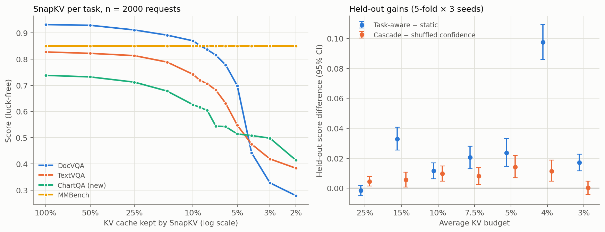

# Experiment: do the SnapKV findings hold at scale and on a new task? (v0.3)

**Why.** Every v0.2 result uses the same 150 requests per dataset. The main claims (SnapKV's cliff between 5%
and 4% KV, task-aware allocation paying off only near the cliff, and cascades beating a shuffled control
when memory is freed before the retry) are the kind that can come from a small sample or one task mix. This
experiment re-tests them with more than 3× the requests and a fourth task, **ChartQA**. Every analysis
choice (budgets, signal, cost model, controls) is fixed in advance and copied from
[`experiments/baselines/`](../baselines/README.md).

**Grid.** All visual tokens; SnapKV at 100, 50, 25, 15, 10, 9–2% KV (13 configs: uncompressed plus 12 SnapKV ratios). Only KV compression varies,
so each request needs one prefill. These are also exactly the configs a cheap-escalation cascade can use
(ADR-0010).

## Pipeline

| Step | Command | Needs | Output (`results/v0.3-scale/`) |
|---|---|---|---|
| 0 | `python experiments/oracle/sweep.py --check` and `--check-attn` | GPU | `EQUIVALENCE PASS`, `ATTENTION PASS` |
| 1 | `python experiments/oracle/sweep.py --n 500 --datasets textvqa,docvqa,mmbench,chartqa --v-ratios 1.0 --kv-methods snapkv --kv-ratios 1.0,0.5,0.25,0.15,0.1,0.09,0.08,0.07,0.06,0.05,0.04,0.03,0.02 --out results/v0.3-scale/oracle_sweep.jsonl` | GPU, a few hours | 2000 requests × 13 configs |
| 2 | `python experiments/scale/analyze.py` | CPU, about 15 min | `scale_analysis.txt`, `scale_results.json` |

The first 150 requests per dataset for TextVQA, DocVQA and MMBench are the v0.2 requests (same shuffle
seed); the rest are new. ChartQA is entirely new.

`analyze.py` also runs on the v0.2 data (it keeps only the KV-only configs), which reproduces the v0.2
numbers on that subset (for example SnapKV's per-task curves and the headroom at 25–3%). The merged v0.2 file is
created by the baselines analysis (see its pipeline):

```bash
python experiments/scale/analyze.py --sweep results/v0.2-baselines-fine/merged_sweep.jsonl --out /tmp/check.json
```

The robustness checks in the results (also in `results/v0.3-scale/`):

```bash
python experiments/scale/analyze.py --budgets 0.1501 --out results/v0.3-scale/check_b0.1501.json
python experiments/scale/analyze.py --datasets textvqa,docvqa,mmbench --out results/v0.3-scale/check_3tasks.json
python experiments/scale/analyze.py --ids-from results/v0.2-baselines/oracle_sweep.jsonl --out results/v0.3-scale/check_v02ids.json
```

## Results

2000 requests (500 per task) × 13 configs on an RTX A5000. Raw output:
[`results/v0.3-scale/scale_analysis.txt`](../../results/v0.3-scale/scale_analysis.txt).

<picture>
  <source media="(prefers-color-scheme: dark)" srcset="../../docs/figures/scale_snapkv_dark.png">
  
</picture>

**Reproducibility.** The 450 requests shared with v0.2 give identical predictions in all 2250 request–config
pairs that were also run on an A5000. Against the fine 2–9% sweep, which ran on an RTX 3090, 96.3% are identical
(133 of 3600 differ, 50 with a different score). This is cross-GPU numerics, not a code change.

### 1. The cliff is real, and it is task-specific

| KV kept | 100% | 25% | 10% | 7% | 5% | 4% | 3% | 2% |
|---|---|---|---|---|---|---|---|---|
| DocVQA | 0.932 | 0.911 | 0.870 | 0.815 | 0.698 | **0.442** | 0.327 | 0.278 |
| TextVQA | 0.827 | 0.813 | 0.742 | 0.682 | 0.547 | 0.475 | 0.419 | 0.383 |
| ChartQA (new) | 0.738 | 0.712 | 0.626 | 0.544 | 0.514 | 0.508 | 0.498 | 0.414 |
| MMBench | 0.850 | 0.850 | 0.850 | 0.850 | 0.850 | 0.850 | 0.850 | 0.850 |

DocVQA's drop between 5% and 4% (0.70 → 0.44) reproduces v0.2 (0.70 → 0.43) on 500 requests. MMBench keeps
every answer at 2% KV. ChartQA is the opposite of both: it loses quality **early** (−0.11 by 10%, where
DocVQA loses −0.06) but has no cliff, and it flattens out around 0.50 below 6%.

### 2. Oracle headroom

The gap between a per-request oracle and the best static ratio is +0.015 [+0.011, +0.022] at 25%,
+0.114 [+0.101, +0.127] at 7.5%, +0.173 [+0.162, +0.189] at 5% and peaks at **+0.258 [+0.244, +0.271] at
4%**, again around DocVQA's cliff.

### 3. Task-aware allocation (held out)

| Budget | 25% | 10% | 7.5% | 5% | 4% | 3% |
|---|---|---|---|---|---|---|
| task-aware − static | −0.002 [−0.005, +0.002] | +0.012 [+0.006, +0.017] | +0.021 [+0.013, +0.028] | +0.024 [+0.015, +0.033] | **+0.097 [+0.086, +0.109]** | +0.017 [+0.012, +0.023] |

The large gain at 4% reproduces v0.2 (+0.102). It comes from moving MMBench to 2–3% KV, which pays for
DocVQA staying above its cliff. Elsewhere the gain is 1–2 points.

**A 15% caveat.** Realized cost is a whole number of tokens, so SnapKV at 15% averages 0.15001 of the full
cache and the pre-registered rule (`cost ≤ budget + 1e-9`) rejects it. Static then falls back to 10%, which
inflates task-aware − static at B = 0.15 to +0.033. With the budget set to 0.1501 the gain is
+0.004 [+0.001, +0.008]. We report both and draw no conclusion from the 15% cell.

### 4. Confidence cascades (memory freed before the retry)

| Budget | 25% | 15% | 10% | 7.5% | 5% | 4% | 3% |
|---|---|---|---|---|---|---|---|
| static | 0.825 | 0.779* | 0.774 | 0.730 | 0.659 | 0.528 | 0.486 |
| task-aware | 0.823 | 0.812 | 0.785 | 0.750 | 0.683 | 0.625 | 0.503 |
| cascade | **0.831** | **0.818** | **0.799** | **0.766** | **0.709** | **0.645** | **0.509** |
| shuffled control | 0.826 | 0.812 | 0.789 | 0.758 | 0.695 | 0.633 | 0.509 |
| cascade − task-aware | +0.008 | +0.006 | +0.014 | +0.016 | +0.026 | +0.020 | +0.006 |
| cascade − shuffled | +0.004 | +0.006 | +0.010 | +0.008 | +0.014 | +0.011 | +0.000 |

\* the 15% caveat above. Both paired differences exclude 0 at every budget except cascade − shuffled at 3%
(full CIs in the raw output).

The cascade is the best method at every budget, and real confidence beats shuffled confidence at 6 of 7.
But the per-request part of the gain is **about 1 point, a third of the 2–4 points v0.2 reported**.

**Why it shrank.** Not from ChartQA and not from the larger sample. On the same 450 requests as v0.2, a
KV-only cascade gains just as little over the shuffled control (+0.024 [+0.010, +0.038] at 5%, CIs
including 0 elsewhere). Without ChartQA (1500 requests) it is +0.004 to +0.022. The v0.2 cascades could also
use visual-token pruning stages. The KV-only cascades here are the ones cheap escalation can run with one
prefill (ADR-0010), and the escalation plan's CV estimate agrees (+0.004 at 7.5%, +0.020 at 5%).

**ChartQA is harder for the signal.** The answer's min log-prob detects a lost answer with AUROC 0.667 on
ChartQA, against 0.847 on DocVQA and 0.801 on TextVQA. Numeric chart answers are often wrong but confident.

### What this changes

- SnapKV's cliff, the headroom around it, and the 4% task-aware gain are robust to 3.3× the data.
- Per-request confidence adds a real but small gain on KV-only grids (about 1 point). The claim
  "cascades add 2–4 points" holds only for v0.2's mixed grid and should not be quoted for cheap escalation.
- A new task changes the picture: ChartQA degrades early and smoothly, so a per-task cliff model would
  need to be learned per task, not assumed.
